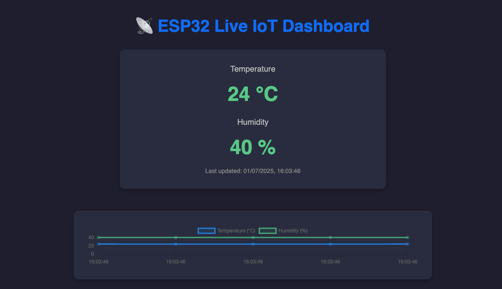
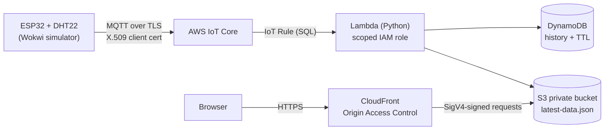
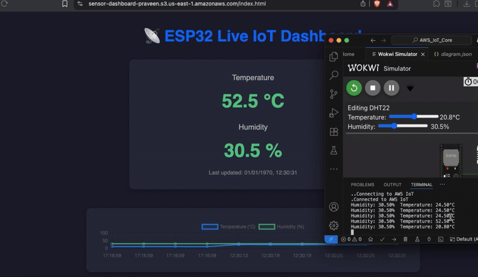

# Secure IoT Telemetry Pipeline on AWS

An edge-to-cloud IoT pipeline that streams simulated ESP32 sensor data into AWS, stores history, and serves a live dashboard, built with **Terraform** and hardened with **least-privilege access** at every layer.



> **Origin and attribution:** The data flow is based on the Whizlabs guided lab *"Wokwi IoT Device Simulation with AWS IoT Core Real-Time Dashboard."* The lab works, but it uses a wildcard IoT policy, a public S3 bucket, and console-only setup. This project rebuilds it in my own AWS account, replaces those shortcuts with proper security controls, and adds DynamoDB history, input validation, and infrastructure as code.

---

## Table of contents

- [Architecture](#architecture)
- [What I changed from the lab](#what-i-changed-from-the-lab)
- [Tech stack](#tech-stack)
- [Repository structure](#repository-structure)
- [Prerequisites](#prerequisites)
- [Deployment](#deployment)
- [Device setup](#device-setup)
- [Security verification](#security-verification)
- [Threat model](#threat-model)
- [Cost](#cost)
- [Clean up](#clean-up)
- [Limitations and future work](#limitations-and-future-work)
- [What I learned](#what-i-learned)
- [Author](#author)

---

## Architecture



**Flow:**

1. The simulated ESP32 reads temperature and humidity from a DHT22 and publishes JSON to the topic `iot/whizlabs` over mutually authenticated TLS.
2. An IoT rule selects the expected fields and adds the device client ID and a **server-side timestamp**.
3. The rule invokes a Lambda function that **validates** the data, writes it to DynamoDB (30-day TTL), and updates `latest-data.json` in S3.
4. A static dashboard, served by CloudFront from the private bucket, polls `latest-data.json` and displays live readings.

## What I changed from the lab

| Area | Lab version | This project |
|---|---|---|
| IoT policy | Allow `*` on `*` | `iot:Connect` and `iot:Publish` only, scoped to one client ID and one topic |
| Dashboard hosting | Public S3 bucket, HTTP website endpoint | Private bucket, CloudFront with OAC, HTTPS enforced, security headers |
| Lambda permissions | Shared lab role | Single-purpose role: one table, one S3 object key, own logs |
| Lambda invocation | Not restricted | `source_arn` and `source_account` conditions on the IoT rule permission |
| Input handling | Trusts the device payload | Type and range validation; bad data is rejected |
| Timestamps | Device uptime (dashboard showed 1970) | Server-side `timestamp()` from the rules engine |
| Data retention | Latest reading only | History in DynamoDB with automatic expiry |
| Secrets handling | Certificates pasted into source | Generated via CLI, git-ignored, never in Terraform state |
| Provisioning | Manual console steps | Terraform (repeatable, reviewable, destroyable) |

## Tech stack

| Layer | Technology |
|---|---|
| Device (simulated) | ESP32, DHT22, C++ / Arduino framework, PlatformIO, Wokwi |
| Messaging | MQTT, AWS IoT Core (X.509 certificate auth, IoT Rules Engine) |
| Compute | AWS Lambda (Python 3.13, boto3) |
| Storage | Amazon DynamoDB, Amazon S3 |
| Delivery | Amazon CloudFront (Origin Access Control) |
| Security and logging | AWS IAM, CloudWatch Logs |
| Infrastructure as code | Terraform (AWS and archive providers) |
| Frontend | Static HTML and vanilla JavaScript |

## Repository structure

```
iot-secure-dashboard/
├── terraform/
│   ├── main.tf                  # all AWS resources
│   ├── variables.tf
│   ├── outputs.tf
│   ├── lambda/
│   │   └── lambda_function.py   # validation + DynamoDB + S3 write
│   └── web/
│       ├── index.html           # dashboard
│       └── error.html
├── device/                      # Wokwi / PlatformIO project (aws_iot_core)
│   └── src/
│       ├── main.cpp
│       └── secrets.h            # git-ignored
├── docs/                        # diagrams and screenshots
├── .gitignore
└── README.md
```

## Prerequisites

- An AWS account and an IAM user or SSO role with permissions to create the resources above (do not use the root user)
- [AWS CLI v2](https://docs.aws.amazon.com/cli/latest/userguide/getting-started-install.html), configured for `us-east-1`
- [Terraform](https://developer.hashicorp.com/terraform/install) 1.6 or newer
- [VS Code](https://code.visualstudio.com/) with the **Wokwi Simulator** and **PlatformIO IDE** extensions, plus a free Wokwi license

## Deployment

### 1. Create the device certificate (outside Terraform)

The private key is written only to your machine and never enters Terraform state.

```bash
mkdir -p device/certs && cd device/certs

aws iot create-keys-and-certificate --set-as-active \
  --certificate-pem-outfile device.pem.crt \
  --public-key-outfile public.pem.key \
  --private-key-outfile private.pem.key \
  --query certificateArn --output text

curl -o AmazonRootCA1.pem https://www.amazontrust.com/repository/AmazonRootCA1.pem

export TF_VAR_certificate_arn="<certificate ARN printed above>"
```

### 2. Deploy the infrastructure

```bash
cd terraform
terraform init
terraform fmt && terraform validate
terraform plan -out tfplan
terraform apply tfplan
terraform output
```

CloudFront takes 5 to 10 minutes to finish deploying. The outputs include `iot_endpoint`, `dashboard_url`, `bucket_name`, and `lambda_role`.

## Device setup

Edit `device/src/secrets.h` (this file is git-ignored):

1. Set `THINGNAME` to `esp32-sim-01`. It must match the client ID in the IoT policy exactly.
2. Set `AWS_IOT_ENDPOINT` to the `iot_endpoint` Terraform output.
3. Paste in `AmazonRootCA1.pem`, `device.pem.crt`, and `private.pem.key` from `device/certs/`.
4. In `main.cpp`, publish to `iot/whizlabs` and remove the subscribe call. The device only publishes, and the policy does not grant `iot:Subscribe` or `iot:Receive`.

Then compile with the PlatformIO checkmark, open `diagram.json`, and press **Run** in the Wokwi simulator. When the serial monitor shows `Connected to AWS IoT`, open the `dashboard_url` and adjust the DHT22 values in the simulator. The page should update within a few seconds.



## Security verification

Each control was tested rather than assumed. Replace the placeholders with your own results and screenshots.

| # | Test | Command or action | Expected | Result |
|---|---|---|---|---|
| 1 | Bucket is private | `aws s3api get-public-access-block --bucket <bucket>` | All four settings `true` | ☐ |
| 2 | No direct S3 access | `curl -I https://<bucket>.s3.us-east-1.amazonaws.com/index.html` | `403 Forbidden` | ☐ |
| 3 | HTTPS enforced | `curl -I http://<cloudfront-domain>` | `301` redirect to HTTPS | ☐ |
| 4 | Security headers present | `curl -I https://<cloudfront-domain>` | HSTS, `x-content-type-options`, etc. | ☐ |
| 5 | Device cannot publish to other topics | Change publish topic to `iot/other` | Dashboard stops updating; IoT logs show authorization failure | ☐ |
| 6 | Device cannot use another client ID | Change `THINGNAME` to `other-device` | Connection refused | ☐ |
| 7 | Malformed data rejected | Publish `{"temperature": 900, "humidity": 40}` from the IoT console test client | Lambda logs "Rejected payload"; no new DynamoDB item | ☐ |
| 8 | Lambda role is scoped | `aws iam simulate-principal-policy` for `s3:PutObject` on `index.html` | `implicitDeny` | ☐ |
| 9 | History stored | Inspect the DynamoDB table | Items with `device_id`, `ts`, `expires_at` | ☐ |

Screenshots live in [`docs/`](docs/).

## Threat model

| Threat | Mitigation |
|---|---|
| Device certificate is stolen | Policy limits it to one client ID and one publish topic; certificate can be deactivated individually |
| Someone discovers the bucket name | Bucket is private, public access is blocked, and only the CloudFront distribution can read it |
| Device sends malformed or malicious data | Rule selects fixed fields; Lambda validates types and ranges; the dashboard writes with `textContent`, not `innerHTML` |
| Device clock is wrong or spoofed | Timestamp is generated server-side by the IoT rules engine |
| Another rule or account invokes the Lambda | `lambda:InvokeFunction` permission is restricted by `source_arn` and `source_account` |
| Compromised Lambda | Role can write one table, one S3 object key, and its own logs only |
| Traffic interception | TLS on the device connection; HTTPS enforced at CloudFront; S3 policy denies non-TLS requests |
| Secrets committed to Git | `.gitignore` covers keys, certs, `secrets.h`, state files; private key never enters Terraform state |

## Cost

Everything used here is serverless or within free-tier-friendly limits. If you destroy the stack after testing, expect a few cents at most. Set an AWS Budget alert as a safeguard.

## Clean up

```bash
cd terraform && terraform destroy

# The certificate was created outside Terraform, so remove it manually
aws iot update-certificate --certificate-id <id> --new-status INACTIVE
aws iot delete-certificate --certificate-id <id>
```

The certificate ID is the hex string at the end of the certificate ARN. Also delete the local `device/certs/` folder.

## Limitations and future work

**Known limitations**

- The device is simulated in Wokwi, not physical hardware.
- A single device with a single certificate; no fleet provisioning.
- The CloudFront default domain is used (no custom domain or WAF).
- The dashboard shows only the latest reading; it does not chart DynamoDB history.
- Terraform state is stored locally.

**Planned improvements**

- [ ] CloudWatch alarm on Lambda errors with SNS email notification
- [ ] Second IoT rule for threshold alerts (for example, temperature above 60)
- [ ] Remote Terraform state in an encrypted, versioned S3 backend with locking
- [ ] GitHub Actions pipeline with `terraform validate` and `tfsec` or `checkov`
- [ ] Custom Content-Security-Policy via a CloudFront response headers policy
- [ ] Dashboard chart backed by a DynamoDB query API
- [ ] Fleet provisioning with unique per-device certificates
- [ ] Replace the simulator with a physical ESP32
- [ ] Industrial protocol bridging (Modbus or OPC UA to MQTT) to extend toward OT/IT integration

## What I learned

- Why per-device X.509 identities and narrowly scoped IoT policies matter more than a working "allow everything" demo
- How Origin Access Control keeps an S3 origin private while still serving a public site
- How to confine a Lambda with IAM, and how resource-based permissions prevent confused-deputy problems
- Why timestamps and validation belong at the trust boundary rather than on the device
- How to verify security controls with negative tests, not just happy-path checks
- How to keep secrets out of both Git history and Terraform state

## Author

**Anabi Asah**
[LinkedIn](https://linkedin.com/in/anabi-asah) · [GitHub](https://github.com/prof-anabi) · anabiasah@gmail.com

## Acknowledgments

- Whizlabs, for the original guided lab this project is based on
- [Wokwi](https://wokwi.com) for the ESP32 simulator
